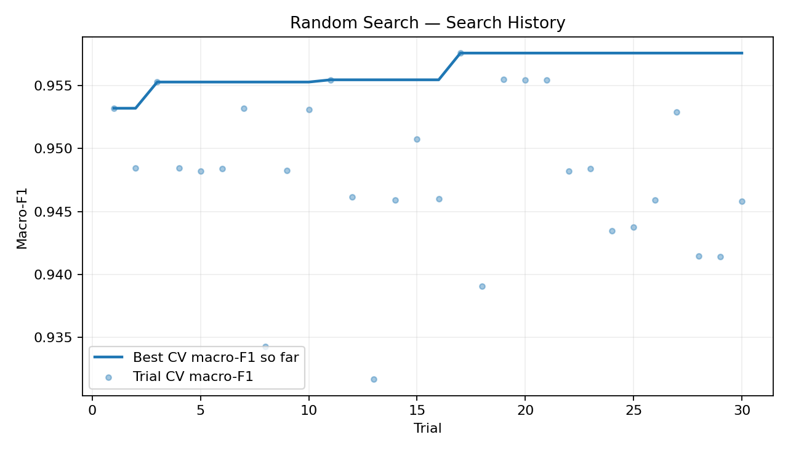
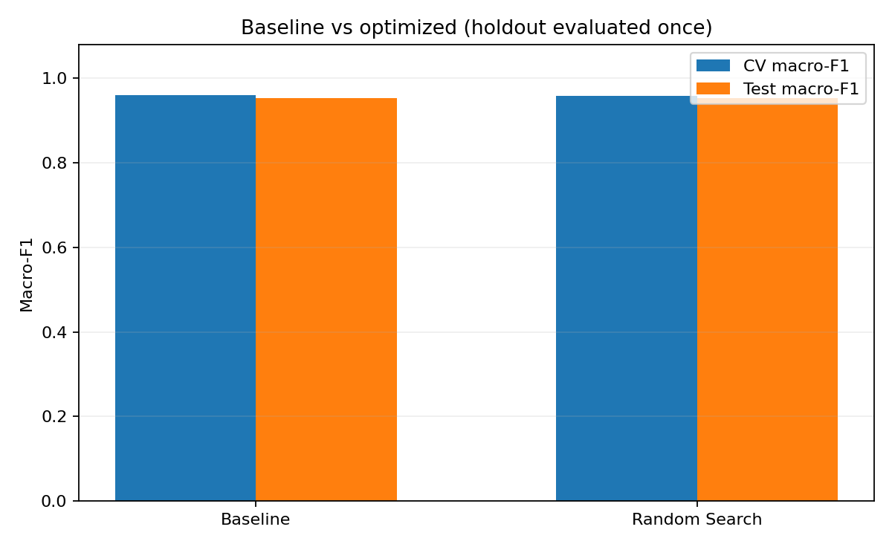
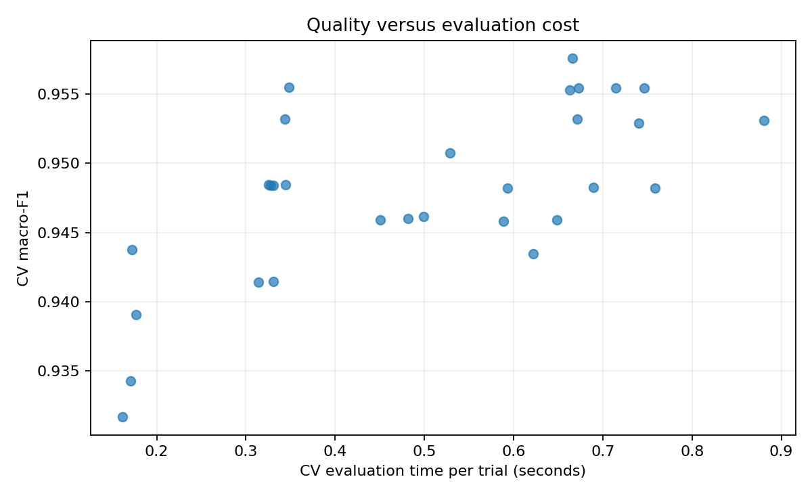

# Experiment Analysis – Random Forest Hyperparameter Optimization

## 1. Mục tiêu thực nghiệm

Thực nghiệm nhằm đánh giá hiệu quả của phương pháp Random Search trong việc tối ưu bốn siêu tham số của mô hình Random Forest trên bộ dữ liệu Breast Cancer Wisconsin (Diagnostic).

Mục tiêu chính là tối đa hóa điểm Macro-F1 thông qua kiểm định chéo 5-fold, đồng thời so sánh chất lượng dự đoán và chi phí tính toán với mô hình Random Forest mặc định (Baseline).

## 2. Cấu hình thực nghiệm

| Thành phần | Giá trị |
|---|---|
| Dataset | Breast Cancer Wisconsin (Diagnostic) |
| Tổng số mẫu | 569 |
| Số đặc trưng | 30 |
| Train/Test Split | 80% / 20% |
| Cross-Validation | Stratified 5-Fold |
| Random Seed | 42 |
| Phương pháp tối ưu | Random Search |
| Số lần thử | 30 |
| Metric chính | Macro-F1 |

Bốn siêu tham số được tối ưu gồm:

- `n_estimators`
- `max_depth`
- `min_samples_split`
- `min_samples_leaf`

## 3. Kết quả so sánh

| Metric | Default Random Forest | Random Search |
|---|---:|---:|
| CV Macro-F1 | 0.9603 | 0.9576 |
| CV Standard Deviation | 0.0188 | 0.0190 |
| Test Macro-F1 | 0.9526 | 0.9526 |
| Test Accuracy | 0.9561 | 0.9561 |
| CV Evaluation Cost | 0.98 s | 14.96 s |
| Final Fit Time | 0.171 s | 0.135 s |

**Nhận xét:**

Mô hình Random Forest mặc định đạt CV Macro-F1 cao hơn Random Search khoảng 0.0027.

Trên tập kiểm thử độc lập, cả hai phương pháp đều đạt Macro-F1 là 0.9526 và Accuracy là 0.9561.

Random Search cần nhiều thời gian đánh giá hơn do thực hiện 30 lần thử. Trong thực nghiệm này, chi phí tìm kiếm bổ sung chưa mang lại sự cải thiện về chất lượng dự đoán.

## 4. Cấu hình tốt nhất của Random Search

Cấu hình đạt điểm CV Macro-F1 cao nhất trong 30 lần thử:

| Hyperparameter | Best Value |
|---|---|
| n_estimators | 80 |
| max_depth | 5 |
| min_samples_split | 4 |
| min_samples_leaf | 2 |

CV Macro-F1 tốt nhất: **0.9576**.

Cấu hình được lựa chọn thông qua kiểm định chéo trên tập huấn luyện, không sử dụng tập kiểm thử để điều chỉnh siêu tham số.

## 5. Phân tích biểu đồ

### 5.1. Search Convergence

Biểu đồ thể hiện lịch sử Macro-F1 của các lần thử và giá trị tốt nhất đã tìm được. Qua đó có thể quan sát quá trình cải thiện nghiệm trong ngân sách 30 lần đánh giá.

### 5.2. Model Comparison

Biểu đồ so sánh Macro-F1 giữa Random Forest mặc định và cấu hình tốt nhất do Random Search tìm được.

Kết quả cho thấy baseline đạt CV Macro-F1 cao hơn, trong khi hiệu quả trên tập kiểm thử của hai phương pháp tương đương.

### 5.3. Performance–Runtime Trade-off

Biểu đồ thể hiện sự đánh đổi giữa chất lượng nghiệm và thời gian tính toán.

Trong trường hợp này, chi phí tìm kiếm bổ sung chưa tạo ra lợi ích tương ứng về hiệu quả dự đoán.

## 6. Phân tích độ nhạy và độ ổn định

### 6.1. Sensitivity Analysis

Kết quả thay đổi `max_depth`:

| max_depth | CV Macro-F1 |
|---|---:|
| 3 | 0.9507 |
| 5 | 0.9576 |
| 10 | 0.9555 |
| 20 | 0.9555 |
| None | 0.9555 |

Trong nhóm cấu hình khảo sát, `max_depth=5` đạt CV Macro-F1 cao nhất.

### 6.2. Stability Analysis

| Method | Mean Macro-F1 | Standard Deviation |
|---|---:|---:|
| Baseline | 0.9594 | 0.0014 |
| Optimized | 0.9553 | 0.0024 |

Baseline có điểm Macro-F1 trung bình cao hơn và độ lệch chuẩn thấp hơn khi thay đổi random seed của mô hình.

Thực nghiệm này chưa đánh giá sự biến thiên của toàn bộ quá trình Random Search qua nhiều seed.

## 7. Kết luận

Trong phạm vi 30 lần thử trên bộ dữ liệu Breast Cancer Wisconsin, Random Search không cải thiện hiệu quả dự đoán so với Random Forest mặc định.

Vì vậy, mô hình Random Forest mặc định được lựa chọn làm cấu hình cuối cùng do đạt hiệu quả tương đương trên tập kiểm thử và không phát sinh chi phí tìm kiếm siêu tham số.

## 8. Tệp minh chứng

Các kết quả trên được lưu trong repository:

- `results/comparison.csv`
- `results/trial_history.csv`
- `results/best_config.json`
- `results/sensitivity.csv`
- `results/stability.csv`
- `results/experiment_config.json`
- `figures/convergence.png`
- `figures/comparison.png`
- `figures/tradeoff.png`

**Repository:** https://github.com/PhuVinh206/random-forest-hyperparameter-optimization
